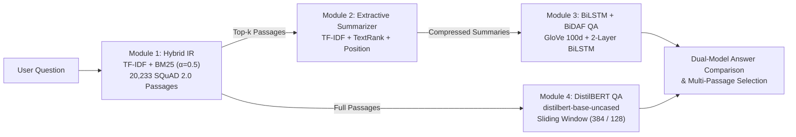

# NLP Pipeline — Open-Domain Question Answering System

An end-to-end **Open-Domain Question Answering (ODQA)** web platform combining hybrid lexical retrieval, extractive text summarization, and side-by-side extractive question answering (**from-scratch BiLSTM + BiDAF** vs. **fine-tuned DistilBERT**).

Built with a **FastAPI + PyTorch + Hugging Face Transformers** backend and a **React + Vite + Tailwind CSS** interactive dashboard featuring both **Demo Mode** (live inference pipeline) and **Learn Mode** (interactive module walkthroughs).

---

## Problem Statement & Motivation

Open-domain question answering requires answering natural-language questions over a large collection of unstructured passages without knowing which passage contains the answer in advance. Passing every document through a neural reader is computationally prohibitive, while relying solely on sparse keyword retrieval can return verbose passages containing distracting sentences.

This project implements a modular three-stage pipeline that:
1. Retrieves the top-*k* most relevant passages from a 20,233-passage corpus.
2. Compresses retrieved passages via multi-signal extractive summarization.
3. Extracts exact answer spans (and detects unanswerable questions under SQuAD 2.0) while directly contrasting a custom-trained **BiLSTM + BiDAF** network against a pretrained **DistilBERT** transformer.

---

## Architecture & Workflow



### Pipeline Stages

| Stage | Module | Method & Implementation | Input / Output |
| :--- | :--- | :--- | :--- |
| **1. Retrieval** | `Module 1` | Min-max normalized fusion of `TfidfVectorizer` (1–2 n-grams, 50k features) and `BM25Okapi` (`k1=1.5`, `b=0.75`) | Query → Top-*k* ranked passages |
| **2. Summarization** | `Module 2` | Weighted sentence scoring: `0.4 × TF-IDF + 0.4 × TextRank (PageRank) + 0.2 × Position`, keeping `ceil(0.3 × n)` (max 5) sentences | Passage → Compressed summary + per-sentence scores |
| **3. QA (From Scratch)** | `Module 3` | 2-layer BiLSTM encoders, Bidirectional Attention Flow (BiDAF), 2-layer modeling LSTM, span & answerability heads (`22.9M` params) | Question + Summary → Answer span + 8×8 attention map |
| **4. QA (Transformer)** | `Module 4` | Fine-tuned `DistilBertForQuestionAnswering` (`66.4M` params) with sliding window (`max_length=384`, `stride=128`) and `[CLS]` null-score thresholding | Question + Full Passage → Answer span + token logits |

---

## Key Features

- **Live End-to-End Pipeline (`Demo Mode`)**: Submit custom or sample questions, inspect ranked TF-IDF/BM25 retrieval scores, view sentence-level extractive compression, and compare BiLSTM+BiDAF vs. DistilBERT predictions side by side.
- **Interactive Educational Explorer (`Learn Mode`)**: Dedicated walkthrough tabs covering the overall pipeline, TF-IDF/BM25 fusion, TextRank graph summarization, BiLSTM+BiDAF architecture, and DistilBERT sliding-window fine-tuning.
- **Unanswerable Question Detection**: Supports SQuAD 2.0 null-span detection (`start_logit + end_logit <= cls_start + cls_end` for DistilBERT; sigmoid threshold for BiLSTM).
- **Reproducible Model Artifacts**: Training notebooks in `notebooks/` plus an automated artifact downloader (`scripts/download_models.py`) linked to the Hugging Face Space (`benzmehdi/nlppro`).
- **Deployment Ready**: Configured for Docker / Hugging Face Spaces (`Dockerfile`, port `7860`) and Netlify (`netlify.toml`).

---

## Technologies & Frameworks

- **Backend**: Python 3.11+, FastAPI, Uvicorn, Pydantic, PyTorch, Hugging Face Transformers, scikit-learn, `rank-bm25`, NetworkX, SciPy, NumPy
- **Frontend**: React 18, TypeScript, Vite 6, Tailwind CSS v4, Motion (`motion/react`), React Router 7, Lucide Icons
- **Training & Experimentation**: Kaggle Notebooks, Hugging Face `datasets` (`rajpurkar/squad_v2`, `abisee/cnn_dailymail`, `EdinburghNLP/xsum`, `hotpot_qa`), `rouge-score`, NLTK

---

## Project Structure

```text
hybrid-ir-extractive-qa/
├── backend/
│   ├── __init__.py
│   ├── main.py                  # FastAPI app, model loaders, and all inference endpoints
│   └── requirements.txt         # Backend Python dependencies
├── notebooks/                   # Kaggle training & evaluation notebooks for Modules 1–4
│   ├── module1-information-retrieval-1 (3).ipynb
│   ├── module2-summarization-1 (2).ipynb
│   ├── module3-question-answering (3).ipynb
│   └── module4-distilbert-squad2 (2).ipynb
├── scripts/
│   └── download_models.py       # Downloads pretrained weights/indexes from HF Space (+ optional GloVe)
├── src/
│   ├── main.tsx                 # React entry point
│   ├── styles/                  # Tailwind CSS v4 & glassmorphism theme styles
│   └── app/
│       ├── App.tsx
│       ├── routes.tsx           # Routes for Demo Mode and Learn Mode
│       ├── api/pipeline.ts      # Typed API client for FastAPI endpoints
│       └── components/          # DemoMode, LearnMode, Root, BackgroundScene, and UI components
├── tests/
│   └── test_api.py              # End-to-end FastAPI TestClient test suite
├── module 4 distilbert/         # DistilBERT tokenizer & config (weights downloaded separately)
├── summ_artifacts/config.json   # Summarizer configuration (method, ratio, max_sents)
├── .github/workflows/ci.yml     # Automated frontend build & backend test workflow
├── Dockerfile                   # Container image for Hugging Face Spaces (port 7860)
├── deploy_to_hf.py              # Helper script to upload backend + artifacts to HF Spaces
├── netlify.toml                 # Netlify frontend build & SPA redirect configuration
├── package.json                 # Frontend dependencies & Vite scripts
├── pnpm-lock.yaml               # Locked frontend dependency graph
├── .env.example                 # Example environment variables
└── CONTRIBUTING.md              # Contribution guidelines
```

---

## Installation & Setup

### Prerequisites

- **Python** 3.11+ (tested on 3.11 in Docker and 3.14 locally)
- **Node.js** 20+ and **pnpm** (or **npm**)

### 1. Clone the Repository

```bash
git clone https://github.com/benzmehdi58-spec/hybrid-ir-extractive-qa.git
cd hybrid-ir-extractive-qa
```

### 2. Backend Environment & Dependencies

Create a virtual environment and install Python packages:

```bash
python -m venv .venv
# Linux / macOS:
source .venv/bin/activate
# Windows (PowerShell):
.venv\Scripts\Activate.ps1

# Optional (recommended on CPU-only machines to avoid downloading CUDA wheels):
pip install torch==2.5.1 --index-url https://download.pytorch.org/whl/cpu

pip install -r backend/requirements.txt huggingface_hub
```

### 3. Download Pretrained Model Artifacts

Large model weights and retrieval indexes are excluded from Git to keep the repository lightweight. Download them from the project's Hugging Face Space using the provided script:

```bash
python scripts/download_models.py
```

This populates:
- `module 1 models/` (`bm25.pkl`, `corpus_index.json`, `tfidf_matrix.npz`, `tfidf_vectorizer.pkl`)
- `module 3 model/qa_best.pt`
- `module 4 distilbert/model.safetensors`

> **Optional — GloVe 100d embeddings for Module 3 (BiLSTM + BiDAF):**  
> Without `glove.6B.100d.txt`, the backend still boots and serves DistilBERT normally, while BiLSTM maps tokens to `<UNK>`. To enable full GloVe vocabulary lookup for BiLSTM:
> ```bash
> python scripts/download_models.py --with-glove
> ```
> *(Downloads `glove.6B.zip` ~822 MB from Stanford NLP and extracts `glove.6B.100d.txt`.)*

### 4. Frontend Dependencies & Environment

```bash
cp .env.example .env.local   # Optional: defaults to http://localhost:8000
pnpm install                 # or: npm install
```

---

## Running the Project

Start the backend and frontend in two separate terminals:

**Terminal 1 — FastAPI Backend (port `8000`):**

```bash
uvicorn backend.main:app --host 0.0.0.0 --port 8000
```

**Terminal 2 — Vite Frontend Dev Server (port `5173`):**

```bash
pnpm dev   # or: npm run dev
```

Open `http://localhost:5173` in your browser.

### Running via Docker (Backend)

```bash
docker build -t nlp-pipeline-api .
docker run -p 7860:7860 nlp-pipeline-api
```

---

## API Endpoints

| Method | Endpoint | Description |
| :--- | :--- | :--- |
| `GET` | `/` | Basic service status check |
| `GET` | `/health` | Returns corpus size (`20233`) and summarization config |
| `POST` | `/api/retrieve` | Hybrid TF-IDF + BM25 passage retrieval (`query`, `top_k`, `alpha`) |
| `POST` | `/api/summarize` | Hybrid extractive passage summarization (`passage`) |
| `POST` | `/api/qa/distilbert` | DistilBERT QA inference (`question`, `context`) |
| `POST` | `/api/qa/bilstm` | BiLSTM + BiDAF QA inference (`question`, `context`) |
| `POST` | `/api/pipeline` | Full end-to-end IR → Summarization → Dual QA pipeline (`query`, `top_k`) |

---

## Datasets & Observed Evaluation Results

All model evaluations below are recorded directly from the execution outputs of the training notebooks in `notebooks/`:

| Module | Dataset | Metric | Observed Notebook Score |
| :--- | :--- | :--- | :--- |
| **Module 1 (Hybrid IR)** | SQuAD 2.0 (500 answerable val samples, 20,233-passage corpus) | Recall@10 | `0.8460` |
| **Module 1 (Hybrid IR)** | SQuAD 2.0 (500 answerable val samples) | MRR | `0.6693` |
| **Module 2 (Summarizer)** | CNN/DailyMail (1,000 val samples) | ROUGE-1 / ROUGE-2 / ROUGE-L | `0.2757` / `0.1045` / `0.2233` |
| **Module 2 (Summarizer)** | XSum (1,000 test samples, cross-domain) | ROUGE-1 / ROUGE-2 / ROUGE-L | `0.1817` / `0.0295` / `0.1211` |
| **Module 3 (BiLSTM + BiDAF)** | SQuAD 2.0 (500 val samples, trained on 19,902 train samples) | Exact Match / F1 | `0.0844` / `0.1518` |
| **Module 3 (BiLSTM + BiDAF)** | HotpotQA (300 val samples, zero-shot) | Exact Match / F1 | `0.0400` / `0.0655` |
| **Module 4 (DistilBERT)** | SQuAD 2.0 (5,928 answerable val samples) | Exact Match / F1 | `0.4685` / `0.6072` |
| **Module 4 (DistilBERT)** | HotpotQA (300 val samples, zero-shot) | Exact Match / F1 | `0.0233` / `0.0636` |

> **Note on UI display values**: Some static educational cards in `Learn Mode` and `Demo Mode` retain earlier target/reference figures from the UI design specification rather than the notebook run numbers above.

---

## Testing

### Backend Automated Tests (`tests/test_api.py`)

With the model artifacts present locally:

```bash
python -m unittest discover -s tests -v
```

Verified result: **7/7 tests passed** (`test_root_and_health`, `test_preprocess_preserves_numbers`, `test_retrieve_valid_and_invalid`, `test_summarize_single_and_multi_sentence`, `test_distilbert_qa_answerable_and_unanswerable`, `test_bilstm_qa_response_shape`, `test_full_pipeline`), plus live Uvicorn HTTP verification on `/health` and `/api/pipeline`.

### Frontend Build Verification

```bash
pnpm build   # or: npm run build
```

Verified result: `vite build` compiles cleanly (`2020 modules transformed`) into `dist/`.

---

## Limitations & Future Improvements

- **GloVe Dependency for Module 3**: `glove.6B.100d.txt` (~347 MB uncompressed) is not bundled; without downloading it via `--with-glove`, BiLSTM maps tokens to `<UNK>`. Storing a compact `word2idx.json` vocabulary for the 200k tokens would remove the 822 MB download requirement at inference time.
- **Learn Mode Interactive Demos**: While `Demo Mode` invokes the live FastAPI backend, the mini-demos inside `Learn Mode` tabs (`ModuleIR`, `ModuleSumm`, `ModuleQA`, `ModuleQADistilbert`) use client-side simulations and can be wired to `/api/retrieve`, `/api/summarize`, `/api/qa/bilstm`, and `/api/qa/distilbert`.
- **Single-Corpus Scope**: Retrieval indexes only the 20,233 unique SQuAD 2.0 passages; adding dense retrieval (e.g., FAISS + sentence-transformers) or multi-hop indexing would improve open-domain coverage and HotpotQA performance.
- **scikit-learn Pickle Compatibility**: `tfidf_vectorizer.pkl` was serialized with `scikit-learn==1.6.1`; running newer versions emits an `InconsistentVersionWarning` (re-exporting or pinning `1.6.1` avoids this).

---

## Contributing

Contributions are welcome! See [CONTRIBUTING.md](CONTRIBUTING.md) for guidelines.

## License

This project is licensed under the [MIT License](LICENSE).
